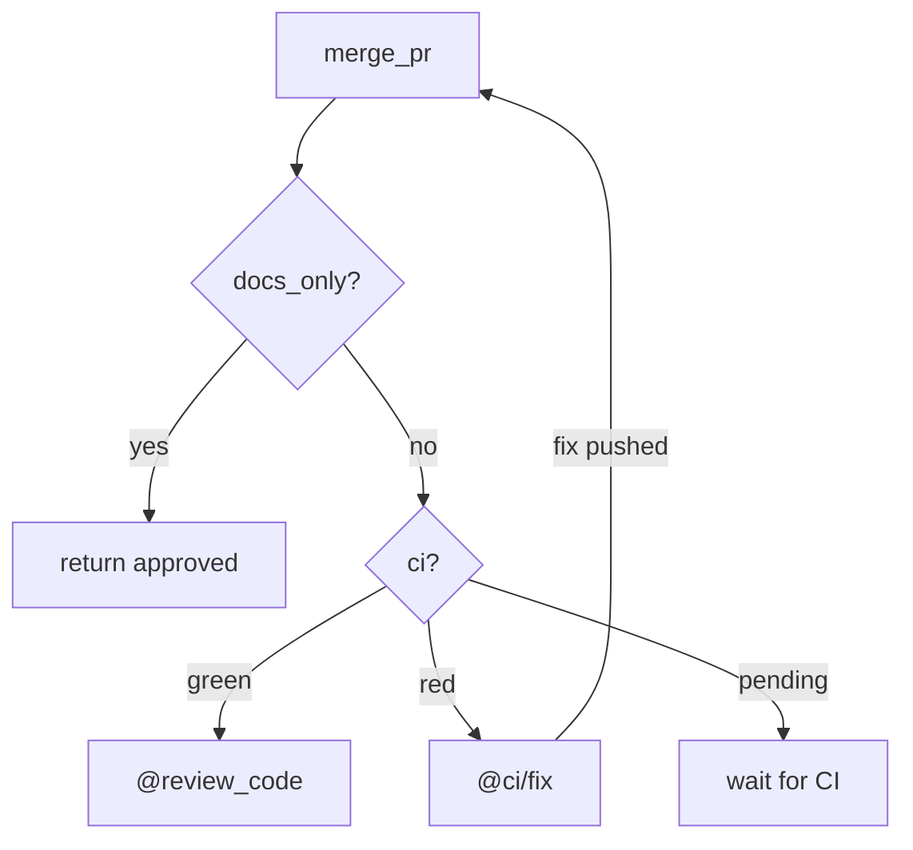

# Rein

Status: proof of concept. Private.

Rein is a language for agent flows. Other tools manage the harness or a graph that the agent runs in. Rein does not. It gives the agent instructions for what to do. Each function is one file. It asks the agent questions, and it returns the next step as text or as a reference to another function. The agent does the step, then asks Rein for the next one.

## Sample

`examples/merge-pr/merge_pr.rein`:

```rein
// merge_pr.rein
/**
 * Decide whether a pull request can be merged.
 *
 * @param docs_only Does the PR change only documentation files?
 * @param ci What is the CI status of the PR?
 */
input docs_only: bool
input ci: choice("green", "red", "pending")

if docs_only {
    return "approved"
}

switch ci {
    case "green" { return @review_code }
    case "red" { return @ci/fix }
    default { return "wait for CI, then run merge_pr again" }
}
```



## How an agent uses it

The agent runs one step at a time. Output below is the intended shape. The format can change during the PoC.

```text
$ rein run
need input task (choice: merge, security review): Which task does the agent do?
hint: rerun with --set task=<value>
# exit 2

$ rein run --set task=merge
@merge_pr
  Decide whether a pull request can be merged.
  docs_only (bool): Does the PR change only documentation files?
  ci (choice: green, red, pending): What is the CI status of the PR?

$ rein run merge_pr --set docs_only=no --set ci=green
@review_code
  Review the code changes in a pull request.
  security_sensitive (bool): Does the PR change authentication, payments, or permissions code?

$ rein run review_code --set security_sensitive=no
Read the diff. Leave comments for bugs and style issues. Approve when the review is clean. Then run merge_pr again.
```

`rein run` with no function runs `main`. Every project has a `main.rein` at its root. It is the agent's entry point. The agent asks the user only for the inputs the path needs. It follows each `@reference` by running that function next.

## Quickstart

```sh
cargo build
cargo run -p rein -- check examples/merge-pr
```

Examples: [merge-pr](examples/merge-pr), [incident-triage](examples/incident-triage), [support-ticket](examples/support-ticket).

## Repository layout

| Path | Contents |
| --- | --- |
| `crates/rein-core` | Lexer, parser, checker, evaluator. |
| `crates/rein` | CLI and language server. |
| `editors/vscode` | VS Code extension. A thin JS client for the language server. |
| `examples` | Example projects. |
| `docs` | Language reference and decisions. |

## Docs

- [Language reference](docs/spec.md): syntax, rules, evaluation, CLI.
- [Decisions](docs/decisions.md): owner facts, PoC choices, open questions.
