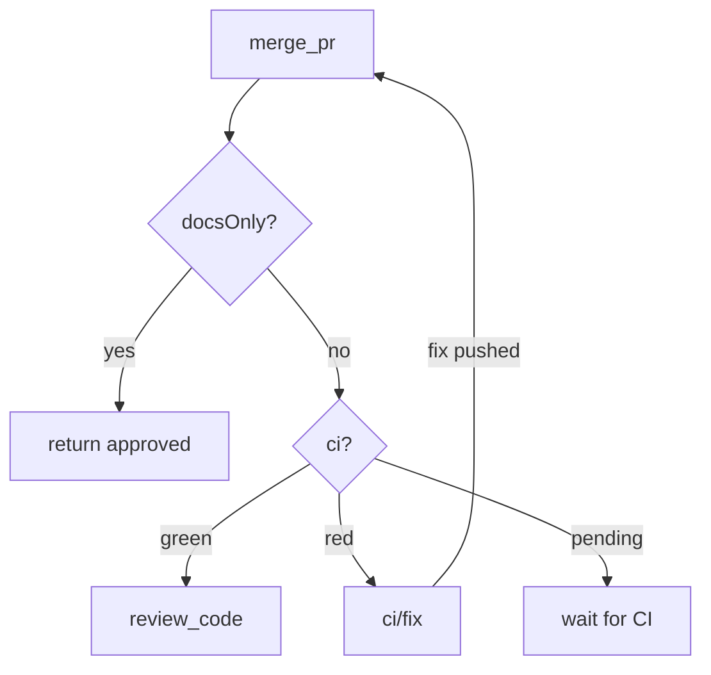

# Rein

Status: proof of concept. Private.

Rein is a language for agent flows. Other tools manage the harness or a graph that the agent runs in. Rein does not. It gives the agent instructions for what to do. Each function is one file. It returns the next step as text, as a reference to another function, or as a template call. When it needs a fact, it asks the agent. When it needs a step done, it sends the agent a request and waits for the answer.

Rein mimics TypeScript syntax and types, except `@` references. There are no imports, no `else`, and no `default`. Every function returns on every path.

## Sample

`examples/merge-pr/merge_pr.rein`:

```ts
// merge_pr.rein

/**
 * Decide whether a pull request can be merged.
 */
export default function mergePr(
  /** Does the PR change only documentation files? */
  docsOnly: boolean,
  /** What is the CI status of the PR? */
  ci: "green" | "red" | "pending",
) {
  if (docsOnly) {
    return "approved";
  }
  switch (ci) {
    case "green":
      return @./review_code;
    case "red":
      return @./ci/fix;
    case "pending":
      return "wait for CI, then run merge_pr again";
  }
}
```



## How an agent uses it

The agent runs one step at a time. The output below is what `rein run` prints today.

```text
$ rein run --root examples/merge-pr
need input task: "merge" | "security review" - Which task does the agent do?
hint: rerun with --set task=<value>
# exit 2

$ rein run --root examples/merge-pr --set task=merge
next: merge_pr
  Decide whether a pull request can be merged.
  docsOnly: boolean - Does the PR change only documentation files?
  ci: "green" | "red" | "pending" - What is the CI status of the PR?

$ rein run merge_pr --root examples/merge-pr --set docsOnly=no
need input ci: "green" | "red" | "pending" - What is the CI status of the PR?
hint: rerun with --set ci=<value>
# exit 2

$ rein run merge_pr --root examples/merge-pr --set docsOnly=no --set ci=green
next: review_code
  Review the code changes in a pull request.
  securitySensitive: boolean - Does the PR change authentication, payments, or permissions code?

$ rein run review_code --root examples/merge-pr --set securitySensitive=yes
Delegate this task to a subagent.
Model: use opus model
Task: code review the pr with a security focus
```

`rein run` with no function runs `main`. Every project has a `main.rein` at its root. It is the agent's entry point. The agent asks the user only for the parameters the path needs. It follows each returned reference by running that function next.

### An async request

`examples/support-ticket/answer/faq.rein` asks the agent to do a step, then branches on the answer. The run stops and asks for the answer (exit code 3). The agent does the step, reports the answer, and runs again:

```text
$ cd examples/support-ticket
$ rein run answer/faq --set articleFound=yes
request: Reply with the help article link and ask the customer if it solved the problem.
then answer: solved: boolean - Did the customer confirm the article solved the problem?
hint: rerun with --set solved=<value>
# exit 3

$ rein run answer/faq --set articleFound=yes --set solved=no
next: escalate
  Hand the ticket to a human support engineer.
# exit 0
```

## Quickstart

```sh
cargo build
cargo run -p rein -- check examples/merge-pr
```

Examples: [merge-pr](examples/merge-pr), [incident-triage](examples/incident-triage), [support-ticket](examples/support-ticket).

Run the editor tests:

```sh
cd editors/vscode
npm install
npm test
```

## Repository layout

| Path | Contents |
| --- | --- |
| `crates/rein-core` | Lexer, parser, checker, evaluator, and the std library (`std/`). |
| `crates/rein` | CLI and language server. |
| `editors/vscode` | VS Code extension. A thin JS client for the language server, a Rein grammar, snippets, and tests. |
| `examples` | Example projects. |
| `docs` | Language reference and decisions. |

## Docs

- [Language reference](docs/spec.md): syntax, rules, evaluation, CLI.
- [Decisions](docs/decisions.md): owner facts, PoC choices, open questions.
