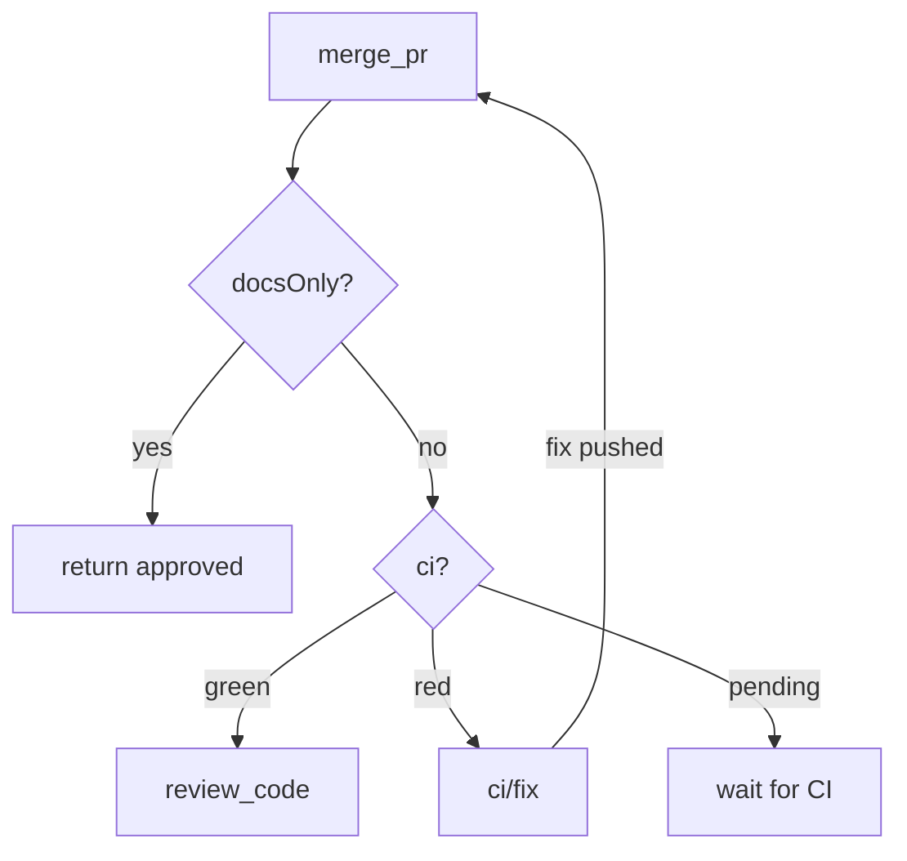

# Rein

Status: proof of concept. Private.

Rein is a language for agent flows. Other tools manage the harness or a graph that the agent runs in. Rein does not. It gives the agent instructions for what to do. Each function is one file. It returns the next step as text, as a reference to another function, or as a template call. When it needs a fact, it asks the agent. When it needs a step done, it sends the agent a request and waits for the answer.

Rein mimics TypeScript syntax and types, except `@` references. There are no imports, no `else`, and no `default`. Every function returns on every path.

## Sample

`examples/merge-pr/merge_pr.rein`:

```ts
// merge_pr.rein

/**
 * Decide whether a pull request can be merged.
 */
export default function mergePr(
  /** Does the PR change only documentation files? */
  docsOnly: boolean,
  /** What is the CI status of the PR? */
  ci: "green" | "red" | "pending",
) {
  if (docsOnly) {
    return "approved";
  }
  switch (ci) {
    case "green":
      return @./review_code;
    case "red":
      return @./ci/fix;
    case "pending":
      return "wait for CI, then run merge_pr again";
  }
}
```



## How an agent uses it

The agent steps the flow with `rein step`. The runtime keeps no state, so each call takes every answer so far. Each call returns one of four kinds: `question`, `request`, `done`, or `error`. The walk below runs `examples/support-ticket`. Each line after `$` is one call. `# exit` is its exit code:

```text
$ cd examples/support-ticket
$ rein step --json
{"kind":"question","version":1,"key":"main.vip","function":"main","name":"vip","type":"boolean","options":null,"description":"Is the customer on the VIP plan?","answers":{},"trace":["main"]}
# exit 2

$ rein step --json --answer main.vip=no
{"kind":"question","version":1,"key":"main.category","function":"main","name":"category","type":"union","options":["billing","account","how_to"],"description":"What category best fits the ticket?","answers":{"main.vip":"no"},"trace":["main"]}
# exit 2

$ rein step --json --answer main.vip=no --answer main.category=how_to
{"kind":"question","version":1,"key":"answer/faq.articleFound","function":"answer/faq","name":"articleFound","type":"boolean","options":null,"description":"Did you find a help article that answers the question?","answers":{"main.category":"how_to","main.vip":"no"},"trace":["main","answer/faq"]}
# exit 2

$ rein step --json --answer main.vip=no --answer main.category=how_to --answer answer/faq.articleFound=yes
{"kind":"request","version":1,"key":"answer/faq.solved","function":"answer/faq","instruction":"Reply with the help article link and ask the customer if it solved the problem.","response":{"name":"solved","type":"boolean","options":null,"description":"Did the customer confirm the article solved the problem?"},"answers":{"answer/faq.articleFound":"yes","main.category":"how_to","main.vip":"no"},"trace":["main","answer/faq"]}
# exit 3

$ rein step --json --answer main.vip=no --answer main.category=how_to --answer answer/faq.articleFound=yes --answer answer/faq.solved=yes
{"kind":"done","version":1,"instruction":"Close the ticket as solved.","answers":{"answer/faq.articleFound":"yes","answer/faq.solved":"yes","main.category":"how_to","main.vip":"no"},"trace":["main","answer/faq"]}
# exit 0
```

A call follows each reference in the same call. The `trace` lists the functions it visited. For a `question` or a `request`, the agent asks the user or does the step, adds the key to its answers, and steps again. Without `--json`, `rein step` prints plain text. `rein run` evaluates one function, for debugging. The protocol and exit codes are in [spec.md section 11](docs/spec.md#11-stepping-agent-interface).

## Quickstart

```sh
cargo build
cargo run -p rein -- check examples/merge-pr
```

Examples: [merge-pr](examples/merge-pr), [incident-triage](examples/incident-triage), [support-ticket](examples/support-ticket).

Run the editor tests:

```sh
cd editors/vscode
npm install
npm test
```

## Repository layout

| Path | Contents |
| --- | --- |
| `crates/rein-core` | Lexer, parser, checker, evaluator, and the std library (`std/`). |
| `crates/rein` | CLI and language server. |
| `editors/vscode` | VS Code extension. A thin JS client for the language server, a Rein grammar, snippets, and tests. |
| `examples` | Example projects. |
| `docs` | Language reference and decisions. |

## Docs

- [Language reference](docs/spec.md): syntax, rules, evaluation, CLI.
- [Decisions](docs/decisions.md): owner facts, PoC choices, open questions.
