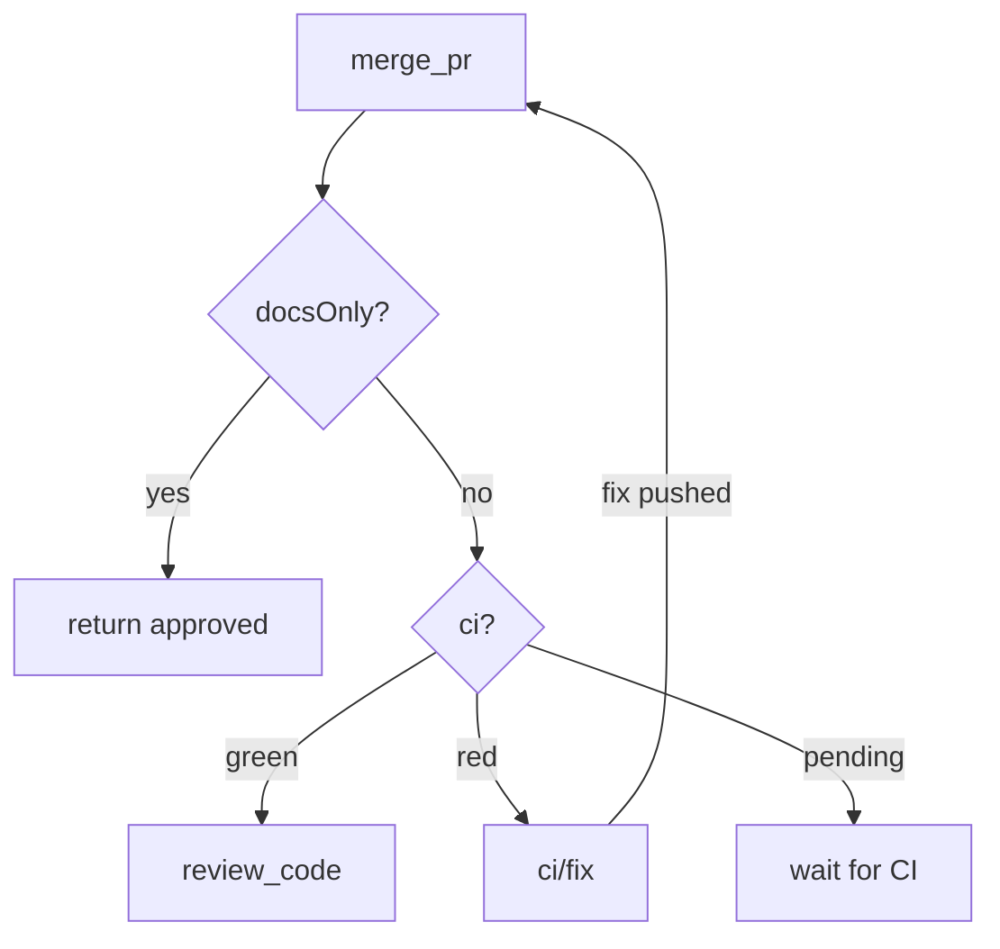

# Rein

Status: proof of concept. Private.

Rein is a language for agent flows. Other tools manage the harness or a graph that the agent runs in. Rein does not. It gives the agent instructions for what to do. Each function is one file. It asks the agent questions, and it returns the next step as text or as an imported function. The agent does the step, then asks Rein for the next one.

Rein is a strict subset of TypeScript. Every Rein file is valid TypeScript syntax, so editors and readers already know how to read it.

## Sample

`examples/merge-pr/merge_pr.rein`:

```ts
// merge_pr.rein
import reviewCode from "./review_code";
import fixCi from "./ci/fix";

/**
 * Decide whether a pull request can be merged.
 */
export default function mergePr(
  /** Does the PR change only documentation files? */
  docsOnly: boolean,
  /** What is the CI status of the PR? */
  ci: "green" | "red" | "pending",
) {
  if (docsOnly) {
    return "approved";
  }

  switch (ci) {
    case "green":
      return reviewCode;
    case "red":
      return fixCi;
    default:
      return "wait for CI, then run merge_pr again";
  }
}
```



## How an agent uses it

The agent runs one step at a time. The output below is what `rein run` prints today.

```text
$ rein run --root examples/merge-pr
need input task: "merge" | "security review" - Which task does the agent do?
hint: rerun with --set task=<value>
# exit 2

$ rein run --root examples/merge-pr --set task=merge
next: merge_pr
  Decide whether a pull request can be merged.
  docsOnly: boolean - Does the PR change only documentation files?
  ci: "green" | "red" | "pending" - What is the CI status of the PR?

$ rein run merge_pr --root examples/merge-pr --set docsOnly=no
need input ci: "green" | "red" | "pending" - What is the CI status of the PR?
hint: rerun with --set ci=<value>
# exit 2

$ rein run merge_pr --root examples/merge-pr --set docsOnly=no --set ci=green
next: review_code
  Review the code changes in a pull request.
  securitySensitive: boolean - Does the PR change authentication, payments, or permissions code?

$ rein run review_code --root examples/merge-pr --set securitySensitive=no
Read the diff. Leave comments for bugs and style issues. Approve when the review is clean. Then run merge_pr again.
```

`rein run` with no function runs `main`. Every project has a `main.rein` at its root. It is the agent's entry point. The agent asks the user only for the parameters the path needs. It follows each returned import by running that function next.

## Quickstart

```sh
cargo build
cargo run -p rein -- check examples/merge-pr
```

Examples: [merge-pr](examples/merge-pr), [incident-triage](examples/incident-triage), [support-ticket](examples/support-ticket).

Check that every example is valid TypeScript syntax:

```sh
cd editors/vscode
npm install
npm run check-ts-syntax
```

## Repository layout

| Path | Contents |
| --- | --- |
| `crates/rein-core` | Lexer, parser, checker, evaluator. |
| `crates/rein` | CLI and language server. |
| `editors/vscode` | VS Code extension. A thin JS client for the language server, a TypeScript grammar, and the syntax check. |
| `examples` | Example projects. |
| `docs` | Language reference and decisions. |

## Docs

- [Language reference](docs/spec.md): syntax, rules, evaluation, CLI.
- [Decisions](docs/decisions.md): owner facts, PoC choices, open questions.
