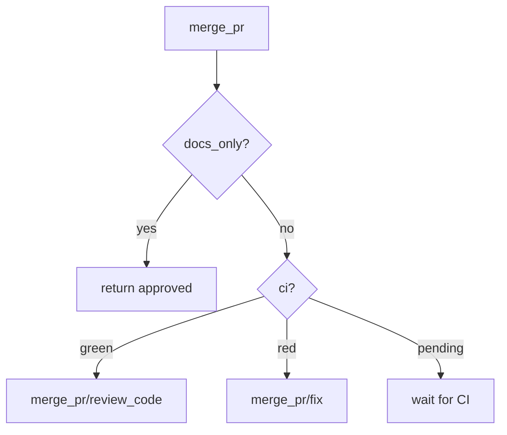

<p align="center"></p>

# Rein

Rein programs are apps for AI agents; skills are manuals.

Status: proof of concept. Syntax can still change.

Agents skip steps in long skill texts. You cannot see which path they took.

A Rein program asks one question at a time. The agent answers, and the program gives the next step.

- **No skipped steps.** The agent gets the next step only after it answers.
- **The same result each run.** The same answers lead to the same step.
- **See what happened.** `rein watch` shows the agents that run now and the step each one waits on. `rein graph` and `rein debug` show the path.
- **Change it safely.** `rein check` reports each place that needs a new case.
- **Install, share and update like an app.** `rein install -g <package>`, `rein list` and `rein update`.
- **The agent finds its apps.** `rein agent-context` and `rein hook` give the agent the list of visible programs. The agent starts the one that matches the task.
- **Asks a person when it must.** A program can stop, ask a person, and branch on the answer.
- **Programs call programs.** One program hands off to another.

Skills teach. Programs run the work. Read more at [rein-lang.com](https://rein-lang.com) and [Rein and skills](https://rein-lang.com/docs/rein-vs-skills).

## The language

Each function is one file. It returns the next step as text, as a reference to another function, or as a template call.

Rein mimics TypeScript syntax and types, except `@` references. Imports name the declared function, such as `import { fix } from "./ci/fix";`. There is no `else`, and no `default` in a `switch`. Every function returns on every path. A function takes one parameter: a scalar or a struct, and a shared struct is a `<name>.struct.rein` file.

Rein is not TypeScript, and it does not handle logic. See [Why not an existing language](https://rein-lang.com/docs/why-not-a-programming-language).

## Sample

`examples/rein/merge-pr/merge_pr.rein`:

```ts
// merge_pr.rein

interface Input {
  /** Does the PR change only documentation files? */
  docs_only: boolean;
  /** What is the CI status of the PR? */
  ci: "green" | "red" | "pending";
}

/**
 * Decide whether a pull request can be merged.
 */
export default function mergePr({ docs_only, ci }: Input) {
  if (docs_only) {
    return `approved`;
  }

  switch (ci) {
    case "green":
      return @./merge_pr/review_code;
    case "red":
      return @./merge_pr/fix;
    case "pending":
      return `wait for CI, then run merge_pr again`;
  }
}
```



## How an agent uses it

The agent steps the process with `rein step`. The runtime keeps no state, so each call takes every answer so far. Each call returns one of four kinds: `question`, `request`, `done`, or `error`. The walk below runs `examples/rein/support-ticket`. Each line after `$` is one call. `# exit` is its exit code:

```text
$ cd examples/rein/support-ticket
$ rein step --json
{"kind":"question","version":1,"key":"main.vip","function":"main","name":"vip","type":"boolean","options":null,"description":"Is the customer on the VIP plan?","answers":{},"trace":["main"]}
# exit 2

$ rein step --json --answer main.vip=no
{"kind":"question","version":1,"key":"main.category","function":"main","name":"category","type":"union","options":["billing","account","how_to"],"description":"What category best fits the ticket?","answers":{"main.vip":"no"},"trace":["main"]}
# exit 2

$ rein step --json --answer main.vip=no --answer main.category=how_to
{"kind":"question","version":1,"key":"faq.article_found","function":"faq","name":"article_found","type":"boolean","options":null,"description":"Did you find a help article that answers the question?","answers":{"main.category":"how_to","main.vip":"no"},"trace":["main","faq"]}
# exit 2

$ rein step --json --answer main.vip=no --answer main.category=how_to --answer faq.article_found=yes
{"kind":"request","version":1,"key":"faq.solved","function":"faq","instruction":"Reply with the help article link and ask the customer if it solved the problem.","response":{"name":"solved","type":"boolean","options":null,"description":"Did the customer confirm the article solved the problem?"},"answers":{"faq.article_found":"yes","main.category":"how_to","main.vip":"no"},"trace":["main","faq"]}
# exit 3

$ rein step --json --answer main.vip=no --answer main.category=how_to --answer faq.article_found=yes --answer faq.solved=yes
{"kind":"done","version":1,"instruction":"Close the ticket as solved.","answers":{"faq.article_found":"yes","faq.solved":"yes","main.category":"how_to","main.vip":"no"},"trace":["main","faq"]}
# exit 0
```

A call follows each reference in the same call. The `trace` lists the functions it visited. For a `question` or a `request`, the agent asks the user or does the step, adds the key to its answers, and steps again. Without `--json`, `rein step` prints plain text. `rein eval` evaluates one function, for debugging. The protocol and exit codes are in [spec.md section 11](https://github.com/rein-lang/rein-lang.com/blob/main/language/spec/stepping.md#11-stepping-agent-interface).

## Homebrew

```sh
brew tap rein-lang/rein https://github.com/rein-lang/rein
brew trust rein-lang/rein
brew install rein
```

Homebrew asks you to trust third-party taps before it installs from them. The formula builds `rein` from source, so the first install takes a few minutes.

## Quickstart

```sh
git submodule update --init             # fetch examples/
cargo install --git https://github.com/rein-lang/rein --tag v0.1.6 --locked rein  # puts `rein` on PATH
cd examples
rein list                               # the programs visible from here
rein run support-ticket                 # run one program by name, answer on stdin
rein graph support-ticket               # its decision graph as Mermaid (--format dot|json, -o graph.svg)
rein serve --mcp                        # the MCP host for agents (see https://github.com/rein-lang/rein-lang.com/blob/main/language/interface.md)
rein watch                              # a page of the agents that use rein now
```

To install, update, or remove a program, see [Install a program](https://github.com/rein-lang/rein-lang.com/blob/main/language/install-programs.md).

Check an example:

```sh
cargo run -p rein -- check examples/rein/merge-pr
```

Examples: [merge-pr](examples/rein/merge-pr), [incident-triage](examples/rein/incident-triage), [support-ticket](examples/rein/support-ticket), [pr-handling](examples/rein/pr-handling), [priority-work](examples/rein/priority-work).

The VS Code extension lives in [rein-lang/vscode-rein](https://github.com/rein-lang/vscode-rein). Its tests run there with `pnpm test`.

The docs site and the landing page live in [rein-lang/rein-lang.com](https://github.com/rein-lang/rein-lang.com) and deploy to https://rein-lang.com.

## Repository layout

| Path | Contents |
| --- | --- |
| `crates/rein-core` | Lexer, parser, checker, evaluator, and the std library (`std/`). |
| `crates/rein` | CLI and language server. |
| [rein-lang/vscode-rein](https://github.com/rein-lang/vscode-rein) | VS Code extension, in its own repo. A thin JS client for the language server, a Rein grammar, snippets, and tests. |
| `examples` | [rein-lang/examples](https://github.com/rein-lang/examples) as a git submodule. Example programs; the tests use them as fixtures. |
| [rein-lang/assets](https://github.com/rein-lang/assets) | Logo and brand files, in its own repo. |
| [rein-lang/videos](https://github.com/rein-lang/videos) | Videos about Rein, such as the concept explainer, in their own repo. |
| [rein-lang/rein-lang.com](https://github.com/rein-lang/rein-lang.com) | Language reference, decisions and the docs site, in its own repo. |

## Docs

- [Language reference](https://github.com/rein-lang/rein-lang.com/blob/main/language/spec.md): syntax, rules, evaluation, CLI.
- [Decisions](https://github.com/rein-lang/rein-lang.com/blob/main/language/decisions.md): owner facts, PoC choices, open questions.
- [Agent interface](https://github.com/rein-lang/rein-lang.com/blob/main/language/interface.md): programs as named apps, the MCP host, and `rein run`.
- [Rein and skills](https://rein-lang.com/docs/rein-vs-skills): the use cases for a skill and for a Rein process.
- [Progressive disclosure](https://rein-lang.com/docs/progressive-disclosure): how a skill and a Rein program give the agent its text.
- [Why not an existing language](https://rein-lang.com/docs/why-not-a-programming-language): why Rein handles decision trees, not logic.

Enable the repo hooks once with `git config core.hooksPath .githooks`. The pre-push hook needs `linecheck` and runs it. It builds `rein` from the branch and runs `rein check` on every installed program (`scripts/check-installed-programs.sh`). A checker change that breaks an installed program blocks the push. The CLI pages of the site are the output of `rein docs-cli`, copied into rein-lang/rein-lang.com.

## Credits

Thanks to [NOPLAB](https://github.com/NOPLAB) for the `rein` name on crates.io ([sard#37](https://github.com/MechanicalGirlDev/sard/issues/37#issuecomment-7093315427)). Versions 0.1.0 and 0.1.1 of the `rein` crate are their earlier library. That library is now [sard](https://github.com/MechanicalGirlDev/sard).

## License

MIT. See [LICENSE](LICENSE).
