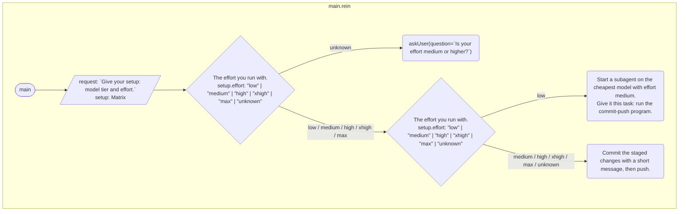

<!--@include: ../../../examples/rein/commit-push/README.md-->

## Graph

The decision flow, from `rein graph commit-push`:

## Source

### `package.json`

<<< ../../../examples/rein/commit-push/package.json{json}

### `rein.json`

<<< ../../../examples/rein/commit-push/rein.json{json}

### `main.rein`

<<< ../../../examples/rein/commit-push/main.rein{rein}
