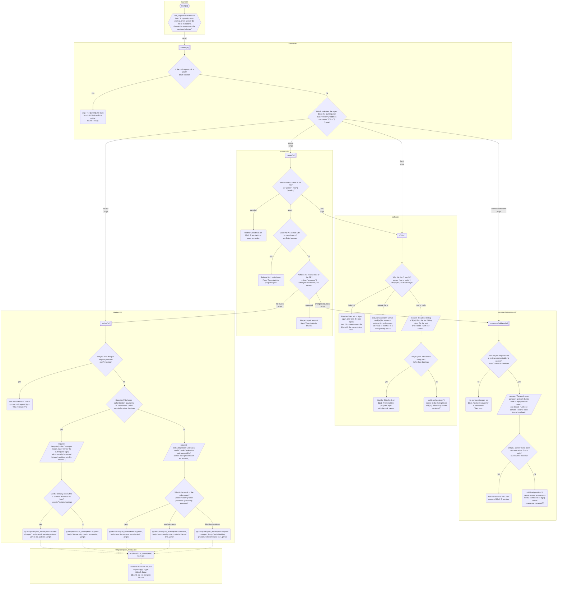

<!--@include: ../../../examples/rein/pr-handling/README.md-->

## Graph

The decision flow, from `rein graph pr-handling`:

## Source

### `package.json`

<<< ../../../examples/rein/pr-handling/package.json{json}

### `rein.json`

<<< ../../../examples/rein/pr-handling/rein.json{json}

### `main.rein`

<<< ../../../examples/rein/pr-handling/main.rein{rein}

### `ci/fix.rein`

<<< ../../../examples/rein/pr-handling/ci/fix.rein{rein}

### `comments/address.rein`

<<< ../../../examples/rein/pr-handling/comments/address.rein{rein}

### `handle.rein`

<<< ../../../examples/rein/pr-handling/handle.rein{rein}

### `merge.rein`

<<< ../../../examples/rein/pr-handling/merge.rein{rein}

### `review.rein`

<<< ../../../examples/rein/pr-handling/review.rein{rein}

### `templates/post_review.rein`

<<< ../../../examples/rein/pr-handling/templates/post_review.rein{rein}
