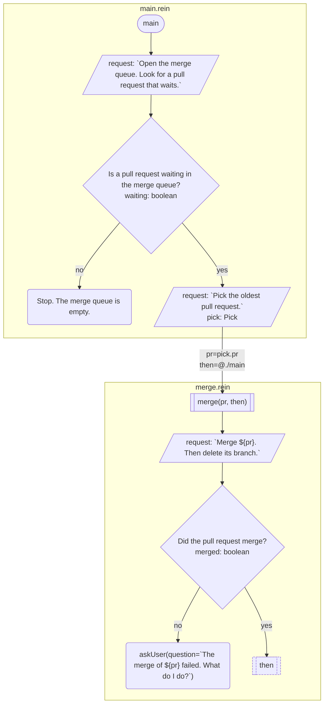

<!--@include: ../../../examples/rein/pr-queue/README.md-->

## Graph

The decision flow, from `rein graph pr-queue`:

## Source

### `package.json`

<<< ../../../examples/rein/pr-queue/package.json{json}

### `rein.json`

<<< ../../../examples/rein/pr-queue/rein.json{json}

### `main.rein`

<<< ../../../examples/rein/pr-queue/main.rein{rein}

### `merge.rein`

<<< ../../../examples/rein/pr-queue/merge.rein{rein}
